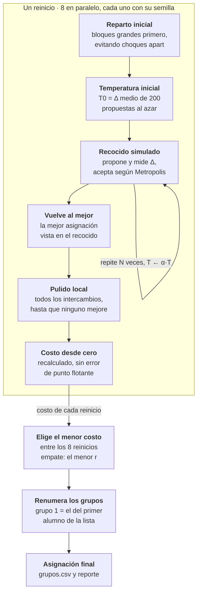

# agrupa: modelo matemático de la formación de grupos

Nov 10, 2026 · @Agustin Rios

## Resumen

agrupa trata la formación de grupos como un problema de optimización: elegir la partición de n alumnos en K grupos que minimiza una suma ponderada de costos, uno por criterio.

Cada costo se mide contra dos referencias propias: su valor ideal y su valor esperado en un reparto al azar. Así, con peso 1, pasar de "al azar" a "ideal" vale exactamente 1 en cualquier columna, sea una nota de 1 a 7 o una lista de habilidades.

Las restricciones duras se cumplen por construcción (bloques que se mueven juntos) o con una penalización que domina al resto del costo. La búsqueda es recocido simulado con reinicios en paralelo y un pulido local final. El mismo modelo, evaluado de forma incremental, sugiere grupo a alumnos nuevos y explica la elección criterio por criterio.

## 1. Planteamiento

El problema es elegir una asignación g que minimice un costo F, sumando criterios blandos ya escalados y una penalización por restricciones duras.

Notación:

- n alumnos, i = 1, …, n; K grupos, k = 1, …, K.
- g(i) es el grupo del alumno i; G_k es el conjunto del grupo k y n_k = |G_k| su tamaño.
- f_c(g) es el costo crudo del criterio c (por ejemplo, cantidad de ausencias de una habilidad).
- I_c es su valor ideal (o una buena cota), R_c su valor esperado al azar y w_c su peso.
- v(g) es la cantidad de pares `apart` que quedaron juntos.

```math
\min_{g}\; F(g) \;=\; \sum_{c} s_c\, f_c(g) \;+\; H\, v(g), \qquad s_c = \frac{w_c}{R_c - I_c}, \qquad H = 1000\,\Big(1 + \sum_c w_c\Big)
```

sujeto a que cada tamaño quede entre los límites y que los bloques `together` compartan grupo:

```math
m_{\min} \le n_k \le m_{\max} \quad \forall k, \qquad g(i) = g(j) \quad \forall\, i, j \in B
```

Para reportar, cada criterio se traduce a una calidad, donde 1 es el ideal y 0 un reparto al azar:

```math
q_c = \min\!\left(1,\; 1 - \frac{f_c - I_c}{R_c - I_c}\right)
```

q_c puede ser negativa: eso indica una asignación peor que el azar, útil al evaluar repartos hechos a mano.

El problema pertenece a una familia conocida. Con solo criterios de diversidad es el Maximally Diverse Grouping Problem (MDGP), que es NP-hard. El criterio `balance` numérico coincide con el anticlustering de k-means: minimizar la variación entre grupos equivale a maximizarla dentro de cada uno. Por eso se usa una heurística y no un método exacto.

## 2. Codificación de los datos

Cada columna del CSV se convierte una sola vez en una forma numérica que permite calcular costos por grupo con sumas y conteos.

| Tipo de dato | Cómo se guarda | Celda vacía o inválida |
| --- | --- | --- |
| Numérico | z_i = x_i − x̄, centrado en la media de los valores conocidos | z_i = 0, es decir, cuenta como la media, con aviso |
| Categórico | Índice del valor (0 o 1 por alumno); sin distinguir mayúsculas | No aporta a ningún conteo, con aviso |
| Etiquetas | Conjunto de índices, separados por coma o punto y coma | Conjunto vacío, con aviso |
| Preferencias | Aristas dirigidas i → j, buscando j por id y luego por nombre exacto | Nombres desconocidos o repetidos se ignoran, con aviso |
| `together` | Bloques B, uniendo las listas con union-find | Ids desconocidos se ignoran, con aviso |
| `apart` | Todos los pares de cada lista, como aristas duras | Un par que también está en un bloque es un error |

Tres decisiones merecen explicación:

- **Centrar los numéricos.** El costo usa Q − S²/n; con valores centrados, S y Q son pequeños y la resta no pierde precisión. Además, imputar con la media equivale a z = 0, que no mueve ninguna suma.
- **Peso de las preferencias.** Si el alumno i eligió a |P_i| compañeros, cada arista pesa 1/|P_i|. Así, quien nombra a cinco no pesa cinco veces más que quien nombra a uno. Cada par a evitar pesa 1.
- **Respuestas duplicadas.** Si un id aparece varias veces, se usa la última fila, como cuando alguien responde el formulario dos veces.

Para cada atributo categórico o de etiquetas, T_v es la cantidad de alumnos con el valor v y c_kv cuántos hay en el grupo k. Para cada numérico, S_k y Q_k son la suma de z y de z² en el grupo k. Con esos agregados se calculan todos los costos.

## 3. Funciones de costo

Cada combinación de tipo y objetivo tiene un costo crudo f que es una suma de términos por grupo. Eso permite recalcular solo los grupos que cambian.

### Numérico · `balance`: promedios parejos entre grupos

```math
f = \sum_k n_k\, \bar z_k^{\,2} = \sum_k \frac{S_k^2}{n_k}
```

Es la suma de cuadrados entre grupos. Como la suma total de cuadrados se reparte en "entre" y "dentro", minimizar esta parte maximiza la variedad dentro de cada grupo: es anticlustering.

### Numérico · `similar`: valores parecidos dentro del grupo

```math
f = \sum_k \Big( Q_k - \frac{S_k^2}{n_k} \Big)
```

Es la suma de cuadrados dentro de los grupos, el mismo objetivo de k-means. Un 1 junto a un 5 cuesta 16 veces más que dos valores separados por 1.

### Categórico o etiquetas · `spread`: cada valor en proporción

Un grupo de tamaño n_k "debería" tener n_k · T_v / n alumnos con el valor v. Como los conteos son enteros, se acepta cualquier valor entre el piso y el techo de esa cifra:

```math
\ell_{kv} = \Big\lfloor \tfrac{n_k T_v}{n} \Big\rfloor, \quad u_{kv} = \Big\lceil \tfrac{n_k T_v}{n} \Big\rceil, \qquad f = \sum_k \sum_v d\big(c_{kv}, [\ell_{kv}, u_{kv}]\big)^2
```

d es la distancia al intervalo (0 si está dentro). Por ejemplo, con 15 mujeres en 30 alumnos, un grupo de 3 cumple con 1 o 2. El piso y el techo se calculan con aritmética entera, sin errores de redondeo. El cuadrado castiga más una gran concentración que varios desvíos pequeños.

### Categórico · `together`: mismo valor dentro del grupo

```math
f = \sum_k \sum_{v < v'} c_{kv}\, c_{kv'} = \sum_k \frac{m_k^2 - \sum_v c_{kv}^2}{2}
```

Cuenta los pares del mismo grupo con valores conocidos distintos; m_k es cuántos tienen dato en el grupo. Se prefiere a "alumnos fuera de la mayoría" porque cambia con cada movimiento, y el recocido avanza mejor sobre un costo suave.

### Categórico o etiquetas · `cover`: la mayor variedad

```math
f = \sum_k \sum_v \mathbf{1}\,[\,c_{kv} = 0\,]
```

Cuenta ausencias: pares (grupo, valor) donde el valor no aparece. En etiquetas busca que cada grupo tenga todas las habilidades. En categóricos, con tamaños fijos, equivale a maximizar cuántos valores distintos hay por grupo.

### Preferencias (blandas) y `apart` (dura)

```math
f_{\text{pref}} = \sum_{(i \to j) \in P} \frac{1}{|P_i|}\, \mathbf{1}[g(i) \ne g(j)] \;+\; \sum_{(i,j) \in A} \mathbf{1}[g(i) = g(j)], \qquad v = \sum_{(i,j) \in D} \mathbf{1}[g(i) = g(j)]
```

P son las elecciones ("quiero trabajar con"), A los pares a evitar y D los pares `apart`. Una elección mutua cuenta dos veces, porque la expresaron dos personas.

## 4. Normalización: ideal y azar

La escala s_c = w_c / (R_c − I_c) hace que el costo esperado de un reparto al azar sea Σ w_c, sin importar las unidades de cada columna. Un test lo verifica con 20.000 repartos al azar: el promedio de cada f_c queda a menos de 2 % de R_c.

### Valor esperado al azar R_c

Un reparto al azar es una partición uniforme con los tamaños n_k fijos, es decir, muestreo sin reposición. Con SS = Σ z_i², la varianza de la media de un grupo es Var(z̄_k) = (SS/n)(n − n_k) / (n_k (n − 1)), lo que da:

```math
R_{\text{balance}} = \sum_k n_k \operatorname{Var}(\bar z_k) = SS\,\frac{K - 1}{n - 1}, \qquad R_{\text{similar}} = SS - R_{\text{balance}} = SS\,\frac{n - K}{n - 1}
```

En los criterios de conteo, c_kv sigue una distribución hipergeométrica: n_k extracciones de una urna de n con T_v éxitos. Se calcula exacta con logaritmos de factoriales:

```math
R_{\text{spread}} = \sum_k \sum_v \sum_{x} \Pr[X_{kv} = x]\; d\big(x, [\ell_{kv}, u_{kv}]\big)^2, \qquad R_{\text{cover}} = \sum_k \sum_v \frac{\binom{n - T_v}{n_k}}{\binom{n}{n_k}}
```

Para `together` y las preferencias basta la probabilidad de que dos alumnos dados compartan grupo, p = Σ n_k(n_k − 1) / (n(n − 1)), y la de que dos alumnos al azar tengan valores conocidos distintos. Con M = Σ T_v:

```math
R_{\text{together}} = \sum_k \binom{n_k}{2} \frac{M^2 - \sum_v T_v^2}{n(n-1)}, \qquad R_{\text{pref}} = \sum_{(i \to j) \in P} \frac{1 - p}{|P_i|} + \sum_{(i,j) \in A} p
```

### Valor ideal I_c

El ideal es el mejor valor posible para ese criterio por sí solo. No siempre hay fórmula cerrada, así que se usa una cota y la calidad se recorta en 100 %.

| Criterio | Ideal I_c | Tipo |
| --- | --- | --- |
| `balance` | 0 | Cota inferior; con pocos alumnos puede no alcanzarse |
| `similar` | Ordenar z y cortar en bloques contiguos con los tamaños (en orden ascendente y descendente; el menor) | Alcanzable |
| `spread` | 0 | Alcanzable para un atributo aislado, redondeando los conteos proporcionales |
| `together` | Llenar cada grupo con el valor más abundante, primero los calces exactos y los vacíos como comodín | Alcanzable, no necesariamente óptimo |
| `cover` | máx(Σ_v máx(0, K − T_v), Σ_k máx(0, V − n_k)); el segundo término solo en categóricos | Cota inferior |
| Preferencias | 0 | Cota inferior |

La cota de `cover` sale de dos límites: un valor con T_v alumnos cubre a lo más T_v grupos, y un grupo de n_k alumnos tiene a lo más n_k valores categóricos distintos. Si R_c − I_c es casi cero, el criterio no tiene variación posible: su escala es 0 y se reporta en 100 %.

## 5. Tamaños y restricciones duras

Con 30 alumnos y `size = 4` salen 8 grupos (6 de 4 y 2 de 3). En empate, agrupa prefiere grupos más chicos a grupos más grandes.

### Cantidad y tamaño de los grupos

1. Si se da `count`, K = count. Si se da `size = s`, K = round(n / s), redondeando 0,5 hacia arriba (más grupos, más chicos).
2. Si hay `max_size`, K sube al menos a ⌈n / max⌉. Si hay `min_size`, K baja a lo más a ⌊n / min⌋.
3. Los tamaños objetivo son parejos: con q = ⌊n / K⌋ y r = n mod K, hay r grupos de q + 1 y K − r de q.
4. Los límites por defecto son [q, q + 1] si r > 0, o [q, q] si no. Si el usuario los amplía, el solver puede mover alumnos y dejar grupos más desparejos cuando eso mejora F.
5. Si los tamaños parejos quedan fuera de [min, max], o K > n, se rechaza la configuración con un mensaje.

### `together`: por construcción

Cada bloque B se trata como una unidad indivisible: se ubica completo en el reparto inicial y solo se mueve completo. Por eso nunca queda separado y no necesita penalización. Un bloque más grande que el tamaño máximo es un error de configuración.

### `apart`: por penalización

Cada par `apart` que comparte grupo suma H = 1000 (1 + Σ w_c) al costo. Como un reparto al azar cuesta del orden de Σ w_c, ninguna mejora blanda compensa una violación y el recocido nunca la acepta. El reparto inicial ya evita estos choques cuando puede. Si una lista `apart` es imposible de cumplir (por ejemplo, más alumnos que grupos), no se detecta antes: el reporte la muestra como incumplida.

## 6. Búsqueda: recocido simulado

Cada reinicio parte de un reparto al azar que cumple las restricciones, lo mejora con recocido simulado y termina con un pulido local. Entre los reinicios gana el de menor costo.



Las flechas siguen un reinicio: los 8 corren a la vez y solo el de menor costo llega a la salida.

### Movimientos

Toda propuesta conserva los bloques `together` y los límites de tamaño:

- **Intercambio.** Se elige un alumno i, otro grupo h y un alumno j de h, todo al azar. Si sus unidades (alumno suelto o bloque) tienen el mismo tamaño, se intercambian.
- **Bloque por sueltos.** Si una unidad es un bloque de s alumnos y la otra un alumno suelto, el bloque se cambia por s alumnos sueltos del otro grupo.
- **Movimiento.** Si los límites dejan margen (min < max), con probabilidad 0,3 la unidad se mueve sin contraparte.

### Aceptación y temperatura

Un cambio con variación de costo Δ se acepta con la regla de Metropolis, y la temperatura baja geométricamente en N iteraciones:

```math
\Pr[\text{aceptar}] = \begin{cases} 1 & \Delta \le 0 \\ e^{-\Delta / T} & \Delta > 0 \end{cases}, \qquad T_{t+1} = \alpha\, T_t, \quad \alpha = \Big(\frac{T_{\text{fin}}}{T_0}\Big)^{1/N}, \quad T_{\text{fin}} = \frac{T_0}{1000}
```

T_0 es el promedio de los Δ positivos en 200 propuestas al azar, sin contar las que violan una restricción dura. Así la temperatura se ajusta sola a la escala de cada problema. Se guarda la mejor asignación vista y se vuelve a ella al terminar.

### Costo incremental

Un cambio toca a lo más dos grupos. Por grupo se guardan n_k, S_k, Q_k y los conteos c_kv; solo se recalculan los términos de esos dos grupos y las aristas de los alumnos movidos, cada una contada una vez. Deshacer es aplicar el cambio inverso. Al final de cada reinicio el costo se recalcula desde cero, para comparar reinicios sin error de punto flotante acumulado.

### Pulido y reinicios

- **Pulido.** Prueba todos los intercambios entre alumnos sueltos de grupos distintos (y los movimientos permitidos) y acepta cada mejora, hasta una pasada sin mejoras (máximo 20). Cuesta O(n²) por pasada, así que se omite sobre 1500 alumnos.
- **Reinicios.** El reinicio r usa la semilla s + r · 0x9E3779B97F4A7C15 y corre en su propio hilo. Gana el menor costo; en empate, el menor r. Por eso el resultado no depende de cuántos núcleos tenga el equipo.
- **Numeración.** Los grupos se renumeran para que el grupo 1 sea el del primer alumno de la lista, y así la salida es estable.

## 7. Sugerencia para alumnos nuevos

`sugerir` recomienda el grupo con menor Δ, el aumento de F al sumar al alumno, sin mover a nadie que ya tenía grupo.

### El Δ marginal

Los alumnos sin grupo quedan fuera de los agregados, y una arista con un extremo sin grupo no cuenta. Sumar la unidad u (un alumno o un bloque de nuevos) al grupo k cambia solo los términos de k y las aristas de u:

```math
\Delta_k(u) = F(g \cup \{u \to k\}) - F(g) = \sum_c s_c\, \Delta f_c + H\, \Delta v
```

La escala s_c se calibra con tamaños parejos para el total de alumnos, incluidos los nuevos. Como Δ es una suma por criterio, cada sumando s_c Δf_c es la explicación: "aporta Diseño UX, que faltaba" corresponde al término negativo de `cover`.

### Cupos

Un grupo tiene cupo si n_k + |u| ≤ límite, donde el límite es `max_size` o, si no hay, el tamaño del grupo más chico + |u|. Sin `max_size`, entonces, se llenan primero los grupos más chicos. Si un nuevo debe ir junto a alguien que ya tiene grupo, solo ese grupo es elegible. Los grupos sin cupo igual se evalúan y se muestran como "agrandando un grupo".

### Tres fases

1. **Ubicación voraz.** Cada unidad nueva, en el orden del archivo, va al grupo elegible con menor Δ.
2. **Re-optimización entre nuevos.** Mientras haya mejora: se saca cada unidad y se vuelve a ubicar con las demás fijas, y se prueban intercambios entre pares de nuevos del mismo tamaño. Esto corrige que el orden del archivo favorezca al primero.
3. **Explicación.** Para cada unidad, con todos los demás nuevos ya ubicados, se recalculan los Δ de todos los grupos y su desglose por criterio. Así la explicación describe la asignación final, no un estado intermedio.

## 8. Validación empírica

Con la configuración por defecto (1.000.000 de iteraciones, 8 reinicios), los 30 alumnos de ejemplo llegan al mejor costo conocido (1,62, frente a 9 de un reparto al azar) en 0,55 s.

### Pruebas automáticas

- **Calibración.** En 20.000 repartos al azar del ejemplo, el promedio de cada f_c queda a menos de 2 % del R_c calculado.
- **Costo incremental.** En 500 cambios al azar, que incluyen sacar alumnos del grupo, el costo incremental coincide con el recalculado desde cero (diferencia < 10⁻⁹).
- **Restricciones y determinismo.** La asignación del ejemplo cumple `together`, `apart` y tamaños, y con la misma semilla sale idéntica.
- **Sugerencia.** Los nuevos van a los grupos de 3 y nadie que ya tenía grupo se mueve.

### Convergencia

El mejor costo conocido (1,6203) se obtuvo con 20 reinicios de 2.000.000 de iteraciones. La tabla mide, para 20 semillas con un solo reinicio, cuántas llegan a ese valor. La última columna es 1 − (1 − p)⁸, la probabilidad de que al menos uno de 8 reinicios llegue.

| Iteraciones por reinicio | Llegan al mejor (de 20) | Con 8 reinicios |
| --- | --- | --- |
| 50.000 | 0 | — |
| 200.000 | 3 | 73 % |
| 1.000.000 | 12 | 99,9 % |

Por esto el valor por defecto subió de 200.000 a 1.000.000. Los reinicios que no llegan quedan cerca: el peor con 1.000.000 cuesta 1,70, un 5 % más.

### Tiempos

Armar con los valores por defecto, en un equipo de 20 hilos. El tiempo de CPU indica cuánto tardaría con un solo núcleo; con 4 núcleos, el tiempo real es cerca de un cuarto de esa cifra.

| Alumnos | Tiempo real (s) | CPU (s) |
| --- | --- | --- |
| 30 | 0,55 | 4,0 |
| 120 | 0,56 | 4,1 |
| 400 | 0,75 | 5,2 |
| 1000 | 3,2 | 18,8 |

Cada iteración cuesta cerca de 0,5 µs. Sobre 400 alumnos el tiempo lo domina el pulido O(n²). Los casos de 120 a 1000 alumnos usan datos sintéticos con 6 criterios, generados al azar.

## 9. Limitaciones y trabajo futuro

La limitación principal es que agrupa no certifica el óptimo: el recocido encuentra soluciones muy buenas, pero no prueba que no exista una mejor.

### Limitaciones conocidas

- **Criterios que se contraponen.** Si dos columnas están correlacionadas, sus objetivos pueden chocar. En la primera versión del ejemplo, compromiso y promedio tenían correlación 0,77: pedir compromiso `similar` juntaba buenas notas y contradecía `balance` en promedio, y compromiso quedaba en −3 %. El modelo lo refleja con honestidad, pero no lo advierte.
- **Ideales que son cotas.** En `balance`, `cover` y preferencias el ideal es una cota inferior que puede no alcanzarse, así que 100 % puede ser imposible. En `together` el ideal es heurístico y la calidad se recorta en 100 %.
- **Preferencias por par.** Cada elección cumplida suma por separado. No se modela "al menos uno de mis elegidos", que es lo que muchas herramientas educativas priorizan.
- **`apart` imposible.** No se detecta antes de buscar; aparece como incumplida en el reporte.
- **Sugerencia local.** `sugerir` nunca mueve a los antiguos. Si llegan muchos nuevos, conviene volver a `armar`.
- **Escala.** El pulido es O(n²) por pasada y se omite sobre 1500 alumnos; ahí la calidad depende solo del recocido.

### Trabajo futuro

- [ ] Avisar cuando dos criterios configurados están muy correlacionados, antes de buscar.
- [ ] Resolver instancias chicas con un método exacto (CP-SAT o programación entera) para certificar el óptimo y medir la brecha del recocido.
- [ ] Balancear también la varianza de los numéricos, no solo la media (k-plus anticlustering).
- [ ] Ofrecer "al menos uno de mis elegidos" como objetivo de preferencias.
- [ ] Detectar listas `apart` con más alumnos que grupos al leer la configuración.

## Referencias

Los enlaces vienen de [Discovery.md](Discovery.md), el documento de exploración del proyecto.

- [Palubeckis (2011), metaheurísticas para el MDGP](https://itc.ktu.lt/index.php/ITC/article/view/977): definición del problema y su dificultad NP.
- [anticlust](https://github.com/m-Py/anticlust/) y [Papenberg y Klau (2021), Psychological Methods](https://zendy.io/title/10.1037/met0000301): anticlustering, base del criterio `balance`.
- [Gallego et al., tabu search para el MDGP](https://fitforthem.unipa.it/rep:6533b836fe1ef96bd12a0ba2) y [recocido simulado adaptativo (AAAI)](https://ojs.aaai.org/index.php/AAAI/article/view/41006/44967): metaheurísticas comparables al recocido de agrupa.
- Kirkpatrick, Gelatt y Vecchi (1983), "Optimization by Simulated Annealing", Science 220: el método de búsqueda.

En el código, cada sección tiene su módulo: [src/model.rs](src/model.rs) (secciones 2 a 4), [src/solver.rs](src/solver.rs) (5 y 6), [src/state.rs](src/state.rs) (costo incremental), [src/suggest.rs](src/suggest.rs) (7) y [tests/ejemplos.rs](tests/ejemplos.rs) (8).
